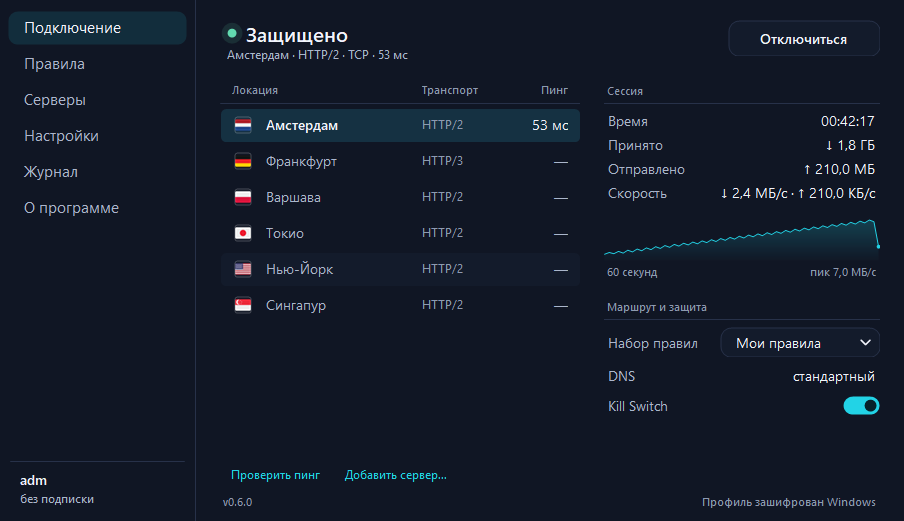

<p align="center"></p>

# Netlane для Windows

Лёгкий VPN-клиент для Windows 10 и 11 x64 на базе TrustTunnel. Подключается к собственному серверу по подписке и поддерживает несколько локаций.

<p align="center"></p>

## Скачать и подключиться

1. Скачайте `Netlane-windows-x64.zip` и файл SHA-256 из [релизов](https://github.com/divezh/netlane-windows/releases/latest).
2. Проверьте контрольную сумму: `(Get-FileHash .\Netlane-windows-x64.zip -Algorithm SHA256).Hash` — она должна совпасть с указанной в файле `.sha256`.
3. Распакуйте **весь архив** в отдельную папку и запустите `Netlane.exe` рядом с папкой `engine`.
4. Скопируйте ссылку на подписку, нажмите **«Вставить»**, затем **«Подключиться»**. Ссылку никому не передавайте.

При подключении Windows попросит разрешение администратора. Ссылку на подписку выдаёт администратор сервера. [Подробная инструкция](clients/windows/README.md).

Серверная часть — панель, ноды и установка на VPS — в отдельном репозитории [divezh/netlane](https://github.com/divezh/netlane).

## Возможности

- HTTP/2 (TCP) и HTTP/3 (QUIC/UDP), Anti-DPI, Kill Switch.
- Несколько серверов по одной подписке, обновление подписки, проверка задержки.
- Маршрутизация доменов, IP и приложений, DNS из подписки или личных настроек.
- При выключенном другом VPN доступна выборочная маршрутизация; ограничения описаны в [инструкции](clients/windows/README.md).

Для правил приложений необходима сборка с модифицированным движком (см. ниже). Управление пользователями, нодами и лимитами выполняется отдельно, в панели сервера.

## Обновления

Приложение проверяет обновления при запуске и по кнопке «Проверить обновления» в «О программе». Источник — ветка [`updates`](https://github.com/divezh/netlane-windows/tree/updates) этого репозитория: при публикации релиза workflow кладёт туда архив и `latest.json` с его SHA-256. Если ветка недоступна, приложение смотрит последний релиз через GitHub API. Архив устанавливается только при совпадении SHA-256. Предварительные релизы (pre-release) не предлагаются.

## Сборка

Нужны Windows x64, .NET Framework 4.8 и PowerShell. Из корня репозитория:

```powershell
powershell -ExecutionPolicy Bypass -File clients\windows\build.ps1 -DownloadEngine
```

Эта команда скачивает проверяемый по SHA-256 официальный движок и создаёт архив `artifacts/Netlane-windows-x64.zip`. **Правила по приложениям в этой сборке недоступны.** Скрипт компилирует клиент и выполняет встроенные тесты.

Для сборки с правилами приложений требуются инструменты сборки TrustTunnelClient (MSVC, Python, Conan, CMake, Ninja и make). В окружении MSVC выполните:

```powershell
powershell -ExecutionPolicy Bypass -File clients\windows\build-routed-engine.ps1
powershell -ExecutionPolicy Bypass -File clients\windows\build.ps1 -DownloadEngine -RoutedEngine "$PWD\research\windows-client\cmake-build-msvc-relwithdebinfo\trusttunnel\trusttunnel_client.exe"
```

Для подписи используйте `-Sign -SignThumbprint <отпечаток>`. Движок с патчем подписывается до расчёта хеша; приложение и тесты — до запуска тестов и упаковки. Закрытый ключ храните отдельно от репозитория. [Подробнее о подписи](docs/SIGNING.md).

## Проверка подлинности

Каждый релиз собирается в GitHub Actions из этого репозитория. Для архива публикуется [аттестация происхождения](https://docs.github.com/actions/security-for-github-actions/using-artifact-attestations) — подтверждение, что файл собран именно этим workflow из этого коммита:

```powershell
gh attestation verify .\Netlane-windows-x64.zip --repo divezh/netlane-windows
```

После одобрения заявки в [SignPath Foundation](https://signpath.org) `Netlane.exe` и движок дополнительно подписываются бесплатной подписью Authenticode от SignPath Foundation; до этого исполняемые файлы не подписаны. Как это настроено — в [docs/SIGNPATH.md](docs/SIGNPATH.md).

## Удаление

Netlane не устанавливается в систему — это папка с программой. Чтобы удалить его:

1. Отключите VPN и закройте Netlane (значок в трее → «Выход»).
2. Если включали «Запускать вместе с Windows» — выключите в «Настройках» (или удалите значение `Netlane` в `HKCU\Software\Microsoft\Windows\CurrentVersion\Run`).
3. Удалите папку с программой и папку данных `%LOCALAPPDATA%\Netlane` (профили, журнал, скачанные обновления).

Маршруты и блокировка Kill Switch действуют только пока VPN подключён и снимаются при отключении.

## Конфиденциальность

Netlane не собирает и не отправляет телеметрию. Программа подключается только:

- к серверам и ссылкам подписки, которые добавил пользователь (подключение VPN, обновление подписки, проверка пинга);
- к GitHub (`raw.githubusercontent.com`, `api.github.com`, `github.com`) — проверка обновлений при запуске и по кнопке, скачивание архива обновления. Передаётся обычный HTTPS-запрос с заголовком `User-Agent: Netlane/<версия>`; GitHub обрабатывает его по своей [политике конфиденциальности](https://docs.github.com/site-policy/privacy-policies/github-general-privacy-statement).

Профили, пароли и ссылки подписки хранятся только на этом компьютере, зашифрованные Windows DPAPI.

## Code signing policy

Free code signing provided by [SignPath.io](https://about.signpath.io), certificate by [SignPath Foundation](https://signpath.org).

Подписываются только `Netlane.exe` и движок `trusttunnel_client.exe`, собранные в GitHub Actions из этого репозитория ([workflow](.github/workflows/build-and-sign.yml)). Каждую подпись релиза вручную одобряет approver.

Team roles:

- Committers and reviewers: [divezh](https://github.com/divezh)
- Approvers: [divezh](https://github.com/divezh)

Privacy policy: see [«Конфиденциальность»](#конфиденциальность). In short: this program will not transfer any information to other networked systems unless specifically requested by the user or the person installing or operating it, except the update check against GitHub described above.

## Безопасность и ограничения

Smart App Control может блокировать неизвестные приложения. Для публичного распространения используйте подпись от доверенного поставщика и проверяйте сборку на чистой Windows. Самоподписанный сертификат предназначен для контролируемых тестов и не гарантирует обход Smart App Control. Не устанавливайте неизвестные корневые сертификаты.

Приложение экспериментальное. О проблемах сообщайте через [Issues](https://github.com/divezh/netlane-windows/issues); не публикуйте ссылки подписки, пароли и журналы с личными данными.

## Лицензии

Собственный код Netlane распространяется под [лицензией MIT](LICENSE). Код TrustTunnel и Wintun распространяются на условиях соответствующих правообладателей, флаги — [Twemoji](https://github.com/twitter/twemoji) (CC-BY 4.0). Тексты лицензий зависимостей входят в готовый архив; лицензия флагов также хранится в `clients/windows/licenses/`.
