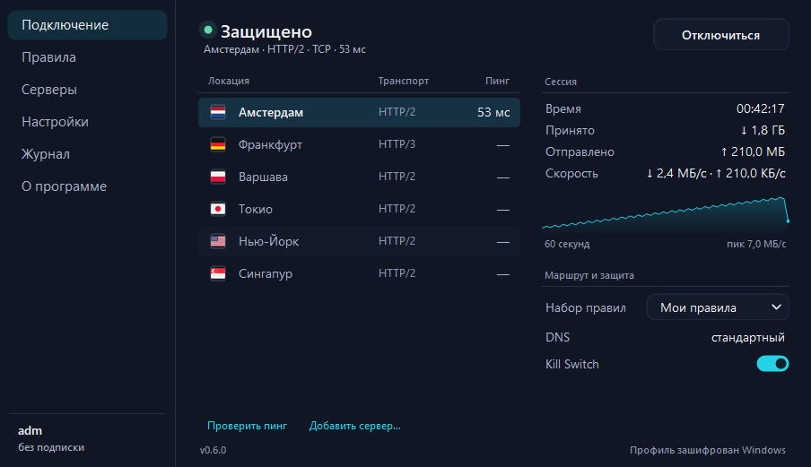

<p align="center"></p>

# Netlane для Windows

VPN-клиент на базе [TrustTunnel](https://github.com/TrustTunnel/TrustTunnelClient): подписки, наборы правил для сайтов и программ, Kill Switch. Windows 10 и 11 (x64). Версия для Mac — [netlane-macos](https://github.com/divezh/netlane-macos).

<p align="center"></p>

## Установка

Скачайте **[Netlane-windows-x64.zip](https://github.com/divezh/netlane-windows/releases/latest/download/Netlane-windows-x64.zip)**, распакуйте целиком и запустите `Netlane.exe`. Затем «Вставить» → ссылка подписки от администратора → «Подключиться».

Файлы не подписаны Authenticode. Если SmartScreen предупредит, нажмите «Подробнее» → «Выполнить в любом случае». Каждый архив подписан ключом владельца ([`netlane-release.pub`](netlane-release.pub), SHA-256 ключа `8c6ed42d…8a8136`); приложение ставит обновления только с этой подписью. Проверка вручную:

```powershell
openssl dgst -sha256 -verify netlane-release.pub -signature Netlane-windows-x64.zip.sig Netlane-windows-x64.zip
gh attestation verify .\Netlane-windows-x64.zip --repo divezh/netlane-windows
```

## Полезное

```powershell
Get-Content "$env:LOCALAPPDATA\Netlane\engine.log" -Tail 50 -Wait   # журнал VPN
Get-Content "$env:LOCALAPPDATA\Netlane\update.log"                  # журнал обновлений
explorer "$env:LOCALAPPDATA\Netlane"                                # настройки и подписки (зашифрованы DPAPI)

# другой VPN занял маршрут по умолчанию и Netlane не подключается (-Restore — вернуть как было)
powershell -ExecutionPolicy Bypass -File .\clients\windows\fix-other-vpn.ps1
```

Правило программы — имя файла, например `chrome.exe`, или полный путь к нему. В панели те же правила действуют и на Mac: там `Google Chrome.exe` означает процесс `Google Chrome` вместе с его Helper-процессами.

**Удаление:** значок в трее → «Выход», затем удалите папку с программой и `%LOCALAPPDATA%\Netlane`. Если был включён автозапуск:

```powershell
Remove-ItemProperty HKCU:\Software\Microsoft\Windows\CurrentVersion\Run -Name Netlane -ErrorAction SilentlyContinue
```

## Сборка

Клиент: C#, WinForms, .NET Framework 4.8, без NuGet.

```powershell
powershell -ExecutionPolicy Bypass -File clients\windows\build.ps1 -DownloadEngine
```

Так собирается клиент с официальным движком, в нём не работают правила программ и DNS через VPN для всех запросов. Полный движок — TrustTunnel 1.3.0 с патчами из `clients/windows/upstream` (`0001` — правила программ и Kill Switch, `0003` — DNS через VPN). Его собирает Actions (`build-engine-ci.ps1`), а локально — `build-routed-engine.ps1` в окружении MSVC с Conan, CMake, Ninja, NASM, GNU Make и Git Bash. Для проверок также нужны Node.js с `markdownlint-cli` (`npm install -g markdownlint-cli`) и clang-format 21 (`python -m pip install 'clang-format>=21,<22'`). Скрипт запускает сборку, C++/Rust-тесты и линтеры. После этого `build.ps1` сам возьмёт собранный движок.

Релиз: поднять `Program.Version` и AssemblyVersion, добавить раздел в CHANGELOG, опубликовать релиз `vX.Y.Z`. Actions соберёт архив; установленные клиенты увидят его как обновление.

[MIT](LICENSE) · [сторонние компоненты](THIRD_PARTY_NOTICES.md) · об уязвимостях пишите приватно через [Security advisories](https://github.com/divezh/netlane-windows/security/advisories/new)
